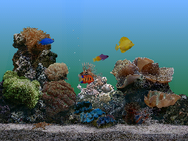

# FroggyAquarium — Marine Aquarium 2 for SF2000 / GB300

A port of the classic **Marine Aquarium 2** screensaver to the Data Frog SF2000
and GB300 handhelds, built as a libretro core for
[`sf2000_multicore`](https://github.com/leonardothehuman/sf2000_multicore)/FrogUI.

It is based on the excellent Linux handheld port by
[`djparentx`](https://github.com/djparentx/marine-aquarium-2.0-screensaver-linux-handheld-port)
(SDL2 + GLES2), but the renderer has been replaced with a from-scratch,
fixed-point software rasterizer that runs on the MIPS CPU **without an FPU**.



## Features

* **320x240 RGB565** framebuffer with a 16-bit Z-buffer.
* **No FPU required**: the whole geometry pipeline (transform, lighting,
  clipping, triangle setup, rasterization, texturing) is integer/fixed point.
  Vertex and pixel hot loops contain no floating point at all.
* Faithful scene port: fish animation, caustic light play, bubble columns,
  starfish, sand/rocks, day/night light cycle and all original settings.
* **MS-ADPCM** bubble audio decoder built into the core (no SDL).
* 4x4 ordered dithering to hide RGB565 banding on the background gradient.
* Works on both **SF2000** (810/918 MHz MIPS) and **GB300**.

## Requirements

1. A GB300 or Data Frog SF2000 running a **multicore firmware** (the
   `sf2000_multicore` loader/FrogUI setup used by other custom cores).
2. The original **Marine Aquarium 2 (2003) game data** from your own CD:
   * `data1.hdr`
   * `data1.cab`

   These files are **not** included in this repository or in the releases.
   Alternatively the core can load a pre-extracted `Marine Aquarium 2.scr`.
3. A FAT32 SD card.

## Installation

### Option A — prebuilt release (recommended)

1. Download the release for your console:
   * **GB300** → `aquarium_GB300V2.gb3k`
   * **SF2000** → `aquarium_SF2000.sf2k`
2. On the SD card create the game folder:
   ```
   /ROMS/aquarium/
   ```
3. Copy the core to the loader's core directory **as `aquarium.sf2k`**
   (the loader always appends `.sf2k`, also on GB300):
   ```
   /system/Deimos/cores/aquarium.sf2k
   ```
   Optionally also copy it to `/cores/aquarium.sf2k` and
   `/ROMS/aquarium/aquarium.sf2k` (some frontends look there).
4. Copy the original CD data into the game folder:
   ```
   /ROMS/aquarium/data1.hdr
   /ROMS/aquarium/data1.cab
   ```
5. Create the launcher stub `/ROMS/aquarium/Aquarium.gba` with exactly this
   text (no newline required):
   ```
   aquarium;aquarium;Aquarium.gba
   ```
6. Optional but recommended: copy `aquarium.ini` (default settings) and the
   thumbnails from `froggyAquarium-sd-files.zip` into `/ROMS/aquarium/`
   and `/ROMS/aquarium/.res/`.
7. Insert the card, boot FrogUI and launch **ROMS/aquarium/Aquarium.gba**.

### Option B — install script

From a checkout of this repository, with the SD card mounted:

```bash
./install_to_sd.sh /media/<user>/<SD_CARD>
```

The script detects GB300 vs SF2000, copies the already-built core from
`dist/`, creates the stub, the config and the thumbnails, and copies
`assets/data1.hdr` + `assets/data1.cab` if they are present in the repo
(put your own files there first). Existing game data on the card is never
overwritten.

### SD card layout (reference)

```
/system/Deimos/cores/aquarium.sf2k     core binary (mandatory)
/ROMS/aquarium/Aquarium.gba            launcher stub (mandatory)
/ROMS/aquarium/data1.hdr               original game data (mandatory)
/ROMS/aquarium/data1.cab               original game data (mandatory)
/ROMS/aquarium/aquarium.ini            settings (optional)
/ROMS/aquarium/.res/Aquarium.png       thumbnail (optional)
/ROMS/aquarium/.res/Aquarium.rgb565    thumbnail (optional)
/configs/custom_cores/aquarium/games.opt   display names (optional)
```

## Controls

| Button | Action |
| --- | --- |
| D-Pad ← / → | background light level |
| D-Pad ↑ / ↓ | foreground light level |
| A | toggle the bubble column |
| START / SELECT | exit back to the menu |

Light levels are written to `aquarium.ini` when you exit.

## Configuration (`aquarium.ini`)

Place `aquarium.ini` next to the game data (`/ROMS/aquarium/aquarium.ini`).
Missing keys keep their defaults.

```ini
FishCount=7              ; number of active fish (1..8)
AllRandom=0              ; 1 = every slot picks a random fish
Fish1=random             ; random, off, or a fish name, e.g. Yellow_Tang
Fish2=random
...
Fish8=off
Sound=1                  ; bubble audio
BubbleColumn=1
AutoLights=1             ; automatic day/night cycle
BackgroundLights=100     ; 0..100
ForegroundLights=100     ; 0..100
StarfishOnGlass=0
StarfishAllowedGlass=1
NoDuplicateRandom=0
CalcNormals=0
Limit60=0
StarFishPos=-3.50
```

## Building from source

### Host tests (no console needed)

```bash
make test          # host renderer + libretro runner, screenshots in screenshots/
make test-mips     # MIPS (musl, soft-float) runner under qemu-mipsel
```

Requirements: `g++`, `zlib`, `ffmpeg` (for PNG screenshots), and for the MIPS
target the `mipsel-linux-muslsf` cross toolchain + `qemu-mipsel` (paths are at
the top of the `Makefile`; edit them if yours differ).

### Console core

Requirements:

* the [frog toolchain](https://github.com/leonardothehuman/sf2000_multicore)
  (`/opt/frog-toolchain/mipsel-mti-elf_stable`) used by `sf2000_multicore`,
* a checkout of `sf2000_multicore` (set `MULTICORE=/path/to/sf2000_multicore`).

```bash
make device FROGGY_TYPE=SF2000     # -> dist/aquarium_SF2000.sf2k
make device FROGGY_TYPE=GB300V2    # -> dist/aquarium_GB300V2.gb3k
```

> **Important:** clean the multicore build directory between the two console
> types (`rm -rf $MULTICORE/build`). The linker script and the BIOS tick
> address differ between SF2000 and GB300V2; a stale `core.elf` will crash on
> the other device.

The resulting core is a normal libretro core archive that the multicore
frontend links and loads from `/system/Deimos/cores/<name>.sf2k`.

## Technical notes

* **Fixed-point pipeline** (no FPU):
  * positions Q8.8, normals Q1.14, matrices Q12.12, clip space Q20.20,
    attributes 16.16 (depth 24.8), screen space 16.16;
  * one integer reciprocal per vertex for the perspective divide;
  * integer triangle setup (edge DDA, planar attribute gradients, 64-bit
    widening multiplies only where needed);
  * scanline-integrated pixel loop with per-state template specialization.
* **Lighting** follows the original Direct3D 6 / GLES port: one parallel-point
  light, ambient + diffuse + optional specular (with a power lookup table),
  texture modulate, alpha test at 32/255, straight alpha blending.
* **Audio**: the original `BUBBLES6H.WAV` is MS-ADPCM; the core decodes it at
  load and plays a looping 44.1 kHz stereo stream (735 frames per frame).
* **Textures** are decoded from DDS (DXT1/3/5) at first use. The art is stored
  bottom-up because it was authored with v=0 at the bottom row.
* The renderer reproduces the GLES reference port with a mean absolute error
  of ~14/255, almost entirely due to nearest-neighbour filtering (the port
  uses `GL_LINEAR`) and RGB565 dithering. See `TEST_REPORT.md`.

### Performance

Host (x86, `-O2`): ≈6 ms/frame.
MIPS under `qemu-mipsel` (40 frames, loaded host): ≈57 ms/frame, split roughly
as: simulation 9 ms, scene/misc 4 ms, vertex pipeline 10 ms, raster 34 ms.
This is about **7x faster** than the first version of the port (≈395 ms/frame
in the same conditions). On real hardware the fixed-point rasterizer scales
well; 30–60 fps is expected (the frontend caps at 60).

## Testing

`make test` verifies:

* deterministic host rendering with a fixed seed (screenshots in
  `screenshots/host/`),
* the libretro core: start-up, D-Pad light changes, bubble toggle, audio
  (72,765 frames / 99 video frames, non-zero samples), and the shutdown
  request from START.

`make test-mips` runs the same libretro test through the MIPS/soft-float
binary under qemu and compares the output. Frames are pixel-identical to the
host except for the scrolling bubble texture (libm rounding differs between
glibc and musl; visually irrelevant).

## Troubleshooting

* **Returns to the menu / black screen right after launch**
  * Make sure `data1.hdr` and `data1.cab` are in `/ROMS/aquarium/`.
  * Check `/mnt/sda1/aquarium.log` (the core logs every stage).
  * Enable boot logging: create an empty file `/bios/enable_xlog.txt` and
    check the multicore log.
* **Core not listed / other cores broken**
  * This core requires the multicore loader (`sf2000_multicore`/FrogUI) to be
    installed. The stock firmware does not load custom `.sf2k` cores.
* **Wrong screen orientation/colors**
  * Use the build matching your console (`GB300V2` vs `SF2000`). Screen-swap
    firmware variants need a matching screen-swap core build.
* **Too slow**
  * Update to firmware 1.6+ if your SF2000 still runs at 810 MHz (1.6+ uses
    918 MHz). Close other cores; the renderer is CPU-bound by design.

## Credits

* Original Linux handheld port and scene decompilation by **djparentx**:
  https://github.com/djparentx/marine-aquarium-2.0-screensaver-linux-handheld-port
* `sf2000_multicore` by **kobily / madcock / leonardothehuman** and the FrogUI
  community.
* `libretro.h` and the libretro API by the libretro team.
* zlib by Jean-loup Gailly and Mark Adler (see `third_party/zlib/LICENSE`).
* Marine Aquarium 2 by **SereneScreen / Encore Software**. This project is a
  fan-made interoperability port. It contains **no game data**: you must own
  and use your own copy of the original CD data.

## Legal

This repository contains only original port code and build scripts. The
Marine Aquarium 2 data files (`data1.hdr`, `data1.cab`, `.scr`, textures,
audio) are copyrighted by their respective owners and are not distributed
here. Use this port only with a legally obtained copy of Marine Aquarium 2.
